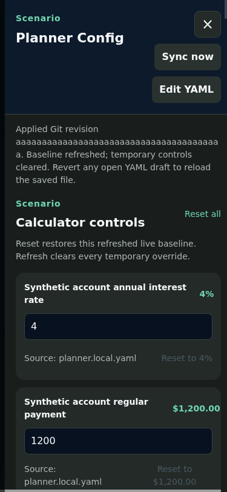

# Git-managed saved plans

The owner edits permanent settings in an already-authorized private Git repository,
then taps **Sync now** beside **Edit YAML** in **Planner Config** to activate that
revision. Browser calculator controls remain temporary what-if inputs. Browser sync
is opt-in; the host helper below remains available for recovery and existing callers.
This procedure does not configure OpenHands Git Sync.

## Enable browser sync once (owner only)

Keep the existing owner-only VPN/private browser access boundary. This feature does
not add user authentication or expose a service. Do not enable it on a public or
shared dashboard. The export-only connection must still deny every operation
except its existing export GET; its credential does not authorize browser sync.

In the existing Portainer stack/Compose deployment, set these private environment
values (no browser inputs select the source):

- `PLANNER_GIT_SYNC_ENABLED=true`
- `PLANNER_GIT_REPOSITORY`: the approved GitHub `owner/repository`
- `PLANNER_GIT_BRANCH`: the branch with committed permanent settings
- `PLANNER_GIT_PATH`: relative YAML file path within that repository
- `PLANNER_GIT_READ_TOKEN`: a fine-grained GitHub credential restricted to that one
  repository with **Contents: read-only** (and required metadata read access)
- `PLANNER_BROWSER_ORIGIN`: the exact origin used by the phone browser, including
  scheme and any nondefault port, with no trailing slash or path

Store the token only in the private server deployment environment; never in YAML,
Git, a URL, a `NEXT_PUBLIC_` variable, screenshots or logs. Provisioning it and
updating the service are owner operations. HTTPS is preferred within the existing
private access boundary. No Git executable or private checkout is needed in the
container. It contacts only `https://api.github.com`, refuses redirects, resolves
the configured branch to a commit and reads/validates that immutable revision.

Use `compose.yaml`, `compose.git-managed.yaml`, then `compose.browser-sync.yaml`.
The last override enables browser sync, forces permanent Save off, and mounts only
the dedicated active-config directory read/write. Standard standalone Save and the
host-only read-only override remain available independently. Validate without
printing resolved secrets:

```bash
docker compose -f compose.yaml -f compose.git-managed.yaml -f compose.browser-sync.yaml config --quiet
```

Keep only the active `planner.local.yaml` in that directory; mount the directory,
not the individual file. Preserve an initial private backup outside it. For the
supplied image, the owner must prepare the directory and active file for UID/GID
1001 (or the chosen service identity). Restrict directory access to that identity
and the owner. Browser sync must be able to create/remove a temporary file and
lock there, read the active file, preserve its owner/group/mode/ACL, and rename
within the directory. Never solve this by running the app as root or granting
write access to other host directories. GNU coreutils is included in the image
for the same permission safeguards used by the recovery helper.

Before using real configuration, the owner should run a disposable copy of the
stack with synthetic YAML and the actual service UID/GID and volume permissions:
verify a valid revision applies, an invalid revision leaves the file unchanged,
and the service can still read the replacement. A rejected permission preflight
must be fixed privately before rollout. `tests/posix-config-sync.ts` separately
exercises the shared activation code with distinct writer/reader identities.

On the phone over the existing VPN, open **Planner Config**. **Sync now** sits next
to **Edit YAML**, remains disabled until the source is configured, and prevents
repeated taps while active. After committing a small deliberate change in GitHub,
tap Sync now and compare the reported full commit with GitHub. The dashboard loads
the saved baseline again and clears temporary controls. Check the intended result.
Existing unsaved YAML drafts remain drafts; use Revert to load the new saved YAML.
If baseline/Lunch Money retrieval fails after activation, the drawer distinguishes
that failure from an unapplied sync; retry Refresh Lunch Money.

To roll back through the browser, revert the YAML change in GitHub on the configured
branch, commit it, and tap Sync now again. Verify the new revert commit and restored
baseline. The exact-ref host procedure below remains another recovery option.
Invalid YAML, upstream timeouts and failed permission preservation/replacement
leave the active file untouched. No configuration or upstream error contents are
returned in sync status. If a network disconnect obscures the result, refresh the
baseline and repeat sync to confirm the revision.

A lock beside the active file coordinates server workers and the host helper.
Do not manually edit the active file or use standalone Save in another process
against it. If the process crashes, a `.sync.lock` file may remain: only after the
owner verifies all sync processes have stopped, remove that lock and retry. Do
not remove it while a sync might still be active.

## Prepare once (owner only)

Use a host-side application source checkout at **the exact revision of the running
planner**, with its lockfile-installed development dependencies (`npm ci`) and
Node 22 or later, Git, and GNU coreutils `cp`. `npm run config:sync` uses `tsx` to run the same complete YAML
validator as that version's editor, including return paths and comparison
configuration. Do not run a newer application's validator against an older service.
Record the deployed application revision in the deployment record and update the
host-side tools whenever the service is upgraded. Validation checks configuration
structure and references, not availability of live Lunch Money records.

Keep the private config checkout and its existing Git authentication on the host,
outside both the application source and the directory mounted into the service.
Use an approved `origin` and explicitly choose its upstream branch. No new access
or private repository setup is performed by this feature.

Keep only active YAML in a dedicated mounted directory. Before the **first** sync,
make a private, access-restricted copy of the initial local file **outside** that
directory and verify that it is readable. Do not overwrite that initial copy on
subsequent syncs. This is the recovery copy for settings that never existed in Git.
The helper replaces only the existing active file; it does not create a backup.

For a Git-managed Compose deployment, use `compose.yaml` with
`compose.git-managed.yaml`. Set `PLANNER_ACTIVE_CONFIG_DIR` to the host's dedicated
active-config directory; its file must be named `planner.local.yaml`. For example,
validate wiring before an owner-controlled deployment:

```bash
PLANNER_ACTIVE_CONFIG_DIR=/srv/planner-active docker compose -f compose.yaml -f compose.git-managed.yaml config --quiet
```

The override forces `PLANNER_CONFIG_WRITE_ENABLED=false` and mounts that directory
read-only at `/app/config`. Mount the **directory**, not an individual file: a
file bind mount can continue pointing at the old inode after atomic replacement.
The existing standalone Compose file keeps its write setting and mount behaviour.
Keep the active directory writable only by the owner/sync operator; the container
user (UID 1001 in the supplied image) must retain read access to the replaced file.
Run sync as the same host user that owns the active file, with membership in its
existing group. Before renaming, the helper uses GNU `cp --attributes-only
--preserve=mode,ownership` to copy the original owner, group, permissions and POSIX
access ACL to the prepared file. This keeps file-specific grants to a separate
service identity. Missing GNU cp or inability to preserve those attributes rejects
the sync before replacement; it never silently changes the access policy. Save stays disabled;
Validate, temporary scenario controls, and in-browser YAML drafts still work.

## Edit, activate, refresh

After editing and committing in GitHub, run from the matching application source
checkout on the host (all paths below are illustrative):

```bash
npm run config:sync -- --checkout /srv/private-planner-config --path plans/retirement.yaml --branch main --active /srv/planner-active/planner.local.yaml
```

`--path` is relative to the private repository root. Each invocation must fetch
`origin`'s specified branch successfully, then defaults to that fetched branch's
commit. The candidate is read from the resolved Git tree, never from dirty or
untracked checkout contents. The checkout's working files are not changed. Only a
regular YAML blob is accepted. Successful validation prepares a temporary file
beside the active YAML and renames it atomically over the active file. Git, file,
validation, and write failures leave the previous active file in place. Run one
sync at a time and do not edit the active file concurrently.

Success reports the exact applied Git commit. Failure reports a generic status,
without Git stderr, paths, YAML values, or credentials. Inspect failures privately
on the host; do not paste private validator or Git output into public issues.

Refresh the dashboard after success. A fresh baseline request reloads the active
YAML and Lunch Money data without a rebuild or restart. A full page reload also
clears temporary browser inputs. The YAML editor's Revert action reloads disk
contents; an unsaved draft is not a permanent plan change.

To select a specific ref or roll back to an earlier known-good commit, use the same
command with `--ref` (the upstream fetch must still succeed):

```bash
npm run config:sync -- --checkout /srv/private-planner-config --path plans/retirement.yaml --branch main --active /srv/planner-active/planner.local.yaml --ref KNOWN_GOOD_COMMIT
```

Record the reported commit and refresh again. Earlier commits must still validate
against the current application version. If restoring the initial non-Git file is
necessary, the owner should validate that private backup with the matching version
before replacing the active YAML atomically in the same directory.

## Retrieve the saved-plan JSON

Set a dedicated, high-entropy `PLANNER_EXPORT_TOKEN` in the private deployment
environment to enable `GET /api/v1/exports/projection`. It is disabled when unset
or empty. Provisioning/changing this environment setting requires the normal
owner-controlled service update; subsequent config syncs do not. Never reuse a
Git credential or the Lunch Money token.

An approved client sends `Authorization: Bearer <dedicated export credential>`.
It sends **no query parameters or body**. Store the credential in that client's
secret facility; do not put it in a URL, source file, shell history, or shared log.
The response is a fresh standard JSON attachment for the saved YAML and current
Lunch Money baseline, with no browser overrides or comparison results. The same
projection engine and typed export allowlist used by the browser POST create it.
Financial amounts are still sensitive even though source identifiers and private
labels are removed. Responses, including failures, use `Cache-Control: no-store`.
Disabled access returns 404, bad/missing credentials 401, supplied inputs 400, and
upstream/configuration/projection failures a sanitized 502.

Bind an authenticated client connection to **only** this GET operation. At an
already-approved TLS gateway, allow the exact path `/api/v1/exports/projection`
and method GET; deny every other path/method for that connection, including the
config, baseline, projection POST, and CSV routes. Forward the Authorization
header, disable response caching, and redact it from access logs. Do not expose
the whole application or publish a new port as part of this change. The export
token is checked only by this operation; it is **not** authentication for the
existing dashboard APIs. Existing browser JSON POST and CSV contracts are
unchanged and must remain behind the deployment's existing access boundary.

This repository makes the planner ready for a later private authenticated client.
Actual credential provisioning, private data access, gateway configuration,
service exposure, and deployment require separate owner-approved operations.

## Synthetic access-preservation validation

`npm test` covers ordinary sync failures, including inability to copy access
attributes. The separate `tests/posix-config-sync.ts` test requires root, Linux
`setpriv`, Python 3, and an ACL-capable temporary filesystem. Run
`sudo node --import tsx tests/posix-config-sync.ts` only in a disposable validation
environment, never on a production host. It copies public code/dependencies (no
private config) into a temporary directory, uses distinct numeric sync and service
identities, and verifies group access, file-specific ACL access, and rejection
when the operator cannot preserve the original group. It removes its fixtures.

After `npm run build`, run `node --import tsx tests/export-http.ts` to verify the
built standalone HTTP boundary with synthetic credentials and no upstream token.
It includes Content-Length and chunked GET bodies: Next omits GET body streams,
so the route rejects body-bearing framing headers before loading the baseline.

Browser sync acceptance uses only synthetic data:

```bash
npm test
node --import tsx tests/browser-sync-http.ts
```

Run the second command after `npm run build`, with Chromium installed (or set
`CHROMIUM_BINARY` to its executable). It starts a disposable built server and a
375px browser, mocks only upstream GitHub/Lunch Money responses, and exercises
keyboard sync, the real HTTP route, atomic write, baseline refresh, invalid YAML,
Git revert rollback, repeat sync, CSRF/input refusal and export-token separation.
The screenshot is written to `/tmp/planner-sync-mobile.png`; temporary service and
browser fixtures are removed. A synthetic example is shown below.



Independent review must cover the exact PR head before owner merge. Hosted Docker
validation is required if local Docker cannot build. Real credential provisioning,
private deployment, permission preflight and the first phone/VPN verification
remain owner operations after deployment; synthetic checks do not claim those ran.
